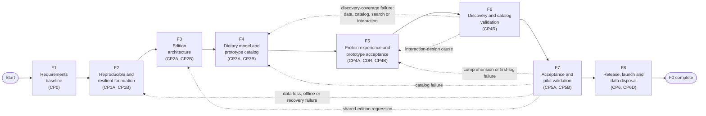
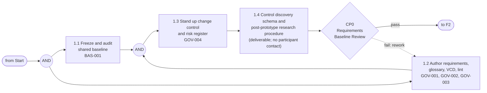
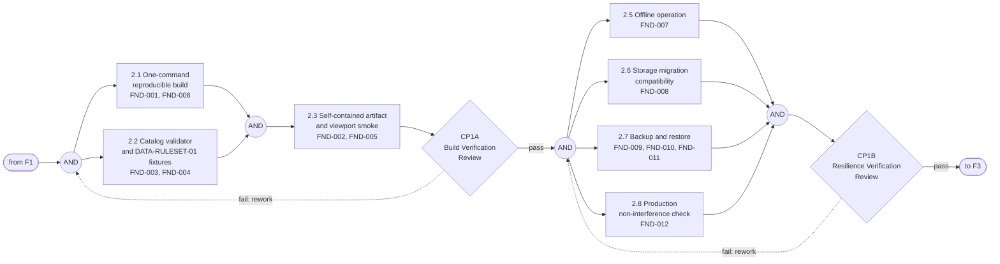
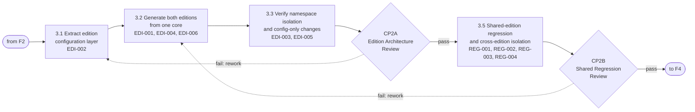
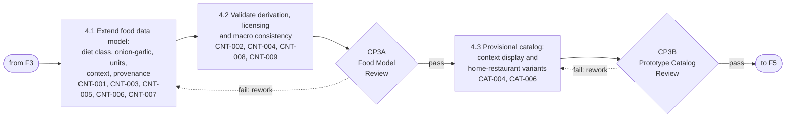
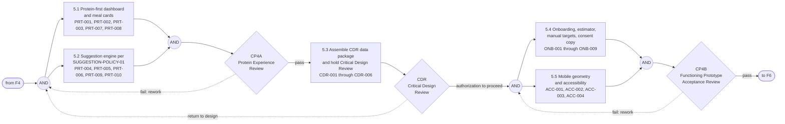
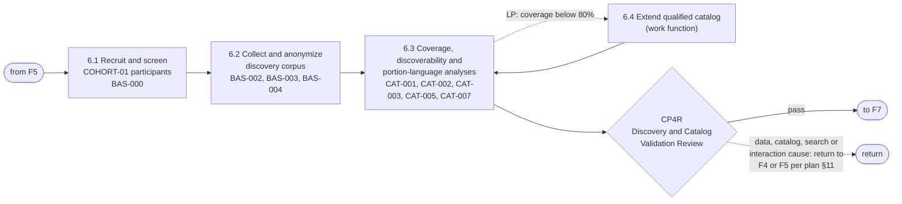
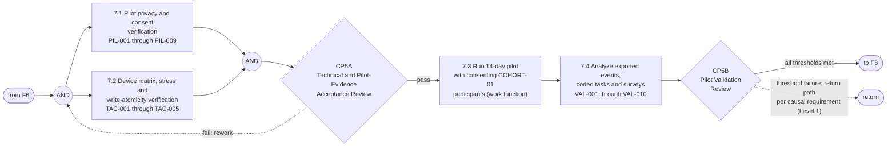
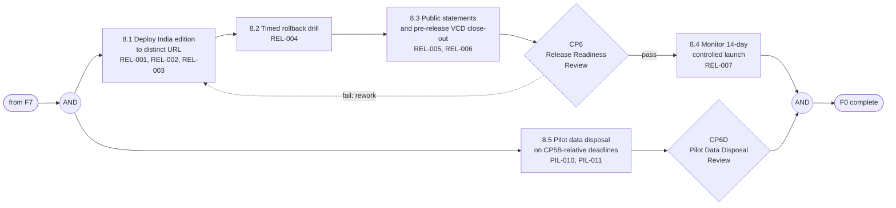
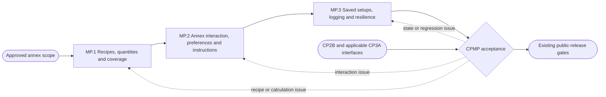

# India Edition Upgrade — Functional Flow Block Diagram (FFBD)

**Status:** Working organizational tool — revision 2
**Date:** 2026-07-16
**Source:** [PLAN-india-upgrade-ecss.md](PLAN-india-upgrade-ecss.md) (baselined at CP0; prototype-first tailoring and CDR insertion per [change-log.md](requirements/change-log.md))
**Convention:** Classic FFBD notation adapted to Mermaid — numbered function blocks, `AND` gates for parallel branches, diamond gates for checkpoint go/no-go decisions, dashed edges for feedback/return paths, `LP` for planned iteration loops.

**Revision 2 changes:** restructured for the prototype-first tailoring (discovery and corpus-based catalog qualification moved from Phase 0/3 to new function F6 at `CP4R`), added the Critical Design Review gate between CP4A and CP4B (function 5.3), added pilot privacy verification (`PIL-`), CP6D data disposal (function 8.5), and renumbered F6→F7, F7→F8.

## How to use this document

- **One function = one unit of trackable work.** A function is *open* until every requirement allocated to it reads `Pass` (or carries an approved waiver) in [vcd.json](requirements/vcd.json), and *closed* when its owning checkpoint gate passes.
- **AND gates mark real concurrency.** Branches leaving an `AND` gate can be worked in parallel; all must complete before the joining gate releases the next function.
- **Dashed edges are plan §11 return paths, not failure states.** They route rework to the checkpoint that owns the causal requirement.
- **`LP` loops are planned iteration** (e.g. extend catalog until corpus coverage ≥ 80% at CP4R), so cycling through them is expected, not a nonconformance.
- All 109 core requirements are allocated to exactly one second-level function (dictionary at the end). The approved 13-requirement meal-prep annex is allocated separately below. A requirements change under GOV-004 updates the allocation here in the same change record.

**Level 0 (mission function):** `F0 — Deliver a validated, independently deployed India edition while preserving the shared edition.` All functions below decompose F0.

**Verification status as of 2026-07-16:** F1 and F2 are closed: CP0, CP1A and CP1B are `Pass`. The repository stakeholder verified `FND-007` by offline-reopen demonstration after the original automated browser attempt was policy-blocked. F3 is active: CP2A is closed, `REG-001` through `REG-004` passed technical verification, and CP2B awaits the stakeholder review decision.

**Progression update 2026-09-05:** CP2B evidence was reviewed and progression authorized by the stakeholder's “go ahead”; see [review-record.md](requirements/evidence/CP2B/review-record.md). F4/CP3A local implementation is active. Later acceptance, pilot, annex qualification and public-release gates remain open.

---

## Level 1 — Top-level functional flow

Return paths are drawn from the functions where failures typically surface, but per plan §11 they apply **regardless of the discovering phase** — a data-loss defect found during F8's controlled launch still returns to F2 (CP1B). A pilot retention failure (VAL-006) triggers product analysis before further feature development rather than a fixed return edge.

---

## Level 2 — F1: Establish requirements baseline (CP0) — **closed**

Closed 2026-07-16. Participant collection is explicitly deferred to F6 (CP4R) by the stakeholder tailoring decision; only the schema and procedure are controlled here.

## Level 2 — F2: Reproducible and resilient foundation (CP1A ✔, CP1B ✔)

CP1A and CP1B closed 2026-07-16. `FND-007` passed by stakeholder offline-reopen demonstration; `FND-008` through `FND-012` passed through the recorded migration, backup/restore and non-interference evidence.

## Level 2 — F3: Edition architecture (CP2A, CP2B)

A CP2B failure blocks **all** later checkpoints (plan §11) — shared-edition behavioral compatibility is a standing invariant from here forward.

CP2A closed with stakeholder approval on 2026-07-16. CP2B technical verification then confirmed the CP0 catalog and defaults, all six named shared-edition flows, and two-way same-origin storage isolation; the checkpoint awaits stakeholder review.

## Level 2 — F4: Dietary model and prototype catalog (CP3A, CP3B)

Per the prototype-first tailoring, CP3B qualifies a **provisional** catalog built on documented assumptions ([prototype-assumptions.md](requirements/prototype-assumptions.md)); corpus coverage is *not* an exit condition here — it is verified against real participant data at F6 (CP4R).

## Level 2 — F5: Protein experience and prototype acceptance (CP4A, CDR, CP4B)

The CDR (framework: [CDR-framework.md](requirements/CDR-framework.md)) sits between functional verification (CP4A) and acceptance (CP4B): it approves the design description and compliance matrix for everything CP4B will verify, checks the pilot-instrumentation privacy trace by design review, and — via `CDR-003` — forces a disposition of any waived or reopened predecessor verification debt before acceptance effort is spent. An unresolved checkpoint blocker cannot be carried forward merely for later CDR disposition. CP4B does not open without the CDR chair's authorization.

## Level 2 — F6: Discovery and catalog validation (CP4R)

First participant contact in the project happens here, after the functioning prototype is accepted. Screening records feed both this checkpoint (`BAS-000`) and later pilot eligibility (`VAL-009`) — recruit with the pilot's stratification needs (`VAL-002`, `VAL-010`) already in mind.

## Level 2 — F7: Acceptance and pilot validation (CP5A, CP5B)

CP5B's close starts two disposal clocks (`PIL-010`: 30 days, `PIL-011`: 90 days) that run through F8 regardless of release progress.

## Level 2 — F8: Release, controlled launch and data disposal (CP6, CP6D)

The disposal branch (8.5) is calendar-driven, not release-driven — it completes on its CP5B-relative deadlines even if the launch is delayed or rolled back.

---

## Function dictionary

| Function | Title | Allocated requirements | Gate (closes it) | Feeds |
|---|---|---|---|---|
| 1.1 | Freeze and audit shared baseline | BAS-001 | CP0 ✔ | 1.3 |
| 1.2 | Author requirements, glossary, VCD, lint | GOV-001, GOV-002, GOV-003 | CP0 ✔ | 1.3 |
| 1.3 | Change control and risk register | GOV-004 | CP0 ✔ | all later functions |
| 1.4 | Control discovery schema and research procedure | — (deliverable) | CP0 ✔ | 6.2 |
| 2.1 | One-command reproducible build | FND-001, FND-006 | CP1A ✔ | 2.3 |
| 2.2 | Catalog validator and fixtures | FND-003, FND-004 | CP1A ✔ | 2.3, 4.2 |
| 2.3 | Self-contained artifact and smoke | FND-002, FND-005 | CP1A ✔ | CP1A gate |
| 2.5 | Offline operation | FND-007 | CP1B ✔ | CP1B gate |
| 2.6 | Storage migration compatibility | FND-008 | CP1B | CP1B gate |
| 2.7 | Backup and restore | FND-009, FND-010, FND-011 | CP1B | CP1B gate |
| 2.8 | Production non-interference | FND-012 | CP1B | CP1B gate |
| 3.1 | Edition configuration layer | EDI-002 | CP2A | 3.2 |
| 3.2 | Generate both editions from one core | EDI-001, EDI-004, EDI-006 | CP2A | 3.3 |
| 3.3 | Namespace isolation, config-only change | EDI-003, EDI-005 | CP2A | CP2A gate |
| 3.5 | Shared regression and isolation | REG-001, REG-002, REG-003, REG-004 | CP2B | CP2B gate |
| 4.1 | Extend food data model | CNT-001, CNT-003, CNT-005, CNT-006, CNT-007 | CP3A | 4.2 |
| 4.2 | Validate derivation, licensing, macros | CNT-002, CNT-004, CNT-008, CNT-009 | CP3A | CP3A gate |
| 4.3 | Provisional catalog context and variants | CAT-004, CAT-006 | CP3B | CP3B gate |
| 5.1 | Protein-first dashboard and cards | PRT-001, PRT-002, PRT-003, PRT-007, PRT-008 | CP4A | CP4A gate |
| 5.2 | Suggestion engine | PRT-004, PRT-005, PRT-006, PRT-009, PRT-010 | CP4A | CP4A gate |
| 5.3 | CDR data package and review | CDR-001–CDR-006 | CDR | CDR gate |
| 5.4 | Onboarding, estimator, targets, consent copy | ONB-001–ONB-009 | CP4B | CP4B gate |
| 5.5 | Mobile geometry and accessibility | ACC-001, ACC-002, ACC-003, ACC-004 | CP4B | CP4B gate |
| 6.1 | Recruit and screen COHORT-01 | BAS-000 | CP4R | 6.2 |
| 6.2 | Collect and anonymize discovery corpus | BAS-002, BAS-003, BAS-004 | CP4R | 6.3 |
| 6.3 | Coverage and discoverability analyses | CAT-001, CAT-002, CAT-003, CAT-005, CAT-007 | CP4R | CP4R gate or LP to 6.4 |
| 6.4 | Extend qualified catalog | — (work function) | CP4R | 6.3 |
| 7.1 | Pilot privacy and consent verification | PIL-001–PIL-009 | CP5A | CP5A gate |
| 7.2 | Device, stress and atomicity verification | TAC-001–TAC-005 | CP5A | CP5A gate |
| 7.3 | Run 14-day pilot | — (work function) | CP5B | 7.4 |
| 7.4 | Analyze pilot evidence | VAL-001–VAL-010 | CP5B | CP5B gate |
| 8.1 | Deploy to distinct URL | REL-001, REL-002, REL-003 | CP6 | 8.2 |
| 8.2 | Timed rollback drill | REL-004 | CP6 | 8.3 |
| 8.3 | Public statements and VCD close-out | REL-005, REL-006 | CP6 | CP6 gate |
| 8.4 | Monitor controlled launch | REL-007 | Launch close-out | F0 complete |
| 8.5 | Pilot data disposal | PIL-010, PIL-011 | CP6D | F0 complete |

**Allocation check:** all 109 plan requirements appear exactly once above (GOV 4, BAS 5, FND 12, EDI 6, REG 4, CNT 9, CAT 7, PRT 10, CDR 6, ONB 9, ACC 4, PIL 11, TAC 5, VAL 10, REL 7). Functions 1.4, 6.4 and 7.3 are pure work functions whose output is verified by the requirements of their successor functions.

## Approved annex — MP: Batch meal preparation (CPMP)

Added 2026-09-05 under the stakeholder-approved [meal-prep annex](PLAN-meal-prep-annex.md). This branch permits local development while existing core review statuses remain unchanged. Acceptance joins the release flow only after CP2B and applicable CP3A interfaces are verified; it does not bypass any original gate.

| Function | Work | Allocated requirements |
|---|---|---|
| MP.1 | Recipe qualification, count rounding, derived nutrition, coverage and sourced storage guidance | `MP-001`, `MP-002`, `MP-004`, `MP-005` |
| MP.2 | Serving definitions, dietary compatibility, accessibility and user-opened instructions | `MP-003`, `MP-010`, `MP-011`, `MP-013` |
| MP.3 | Saved setup snapshots, serving logs, backup, offline operation and shared regression | `MP-006`, `MP-007`, `MP-008`, `MP-009`, `MP-012` |

Practical recipe checks, reference-device acceptance and the five-user formative check remain pending until performed; implementation alone cannot close CPMP.

## Approved annex — FL: Fast logging (CPFL)

Added 2026-09-06 under the stakeholder-approved [fast-log annex](PLAN-fast-log.md) and registered 2026-11-06. India-only behind `features.fastLog`; the shared edition is unaffected.

| Function | Work | Allocated requirements |
|---|---|---|
| FL.1 | Rank and re-log the user's own meals with undo | `FL-001`, `FL-002`, `FL-003` |
| FL.2 | Dashboard picks and the week/month view | `FL-004`, `FL-005`, `FL-006` |
| FL.3 | Release packaging and shared-edition isolation | `FL-007`, `FL-008` |

**Combined allocation:** 109 core, 13 meal-prep annex and 8 fast-log annex requirements = 130.
